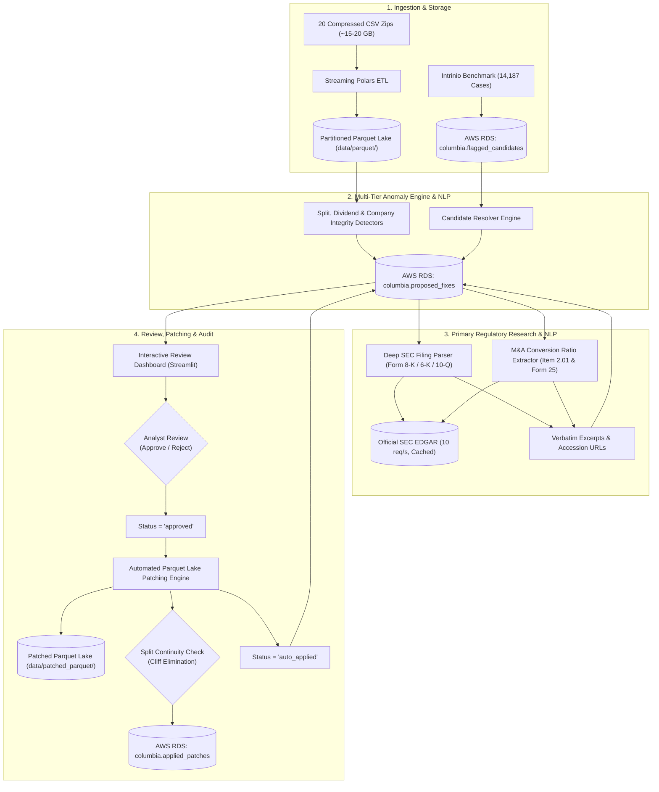

# Corporate Action Integrity and Repair System
**Columbia University Capstone Project in Partnership with Intrinio**  
**Team Members:** Ayon (Team Lead / Data Engineer) & Yining (Analyst / QA)  
**Sponsor:** Matt / Intrinio  

An enterprise-grade automated data cleanup and ongoing monitoring system for US equities and OTC corporate actions. Ingests raw historical price feeds and benchmark anomaly sets, automatically discovers and verifies corporate action anomalies via primary regulatory filings (SEC EDGAR), generates standardized machine-readable proposed repairs, manages a human-in-the-loop analyst review dashboard on AWS RDS PostgreSQL, and executes automated dataset patching across a 20-file Parquet data lake.

---

## 🚀 Key System Capabilities & Metrics

| Component | Status | Metric / Output |
| :--- | :---: | :--- |
| **Benchmark Candidate Ingestion** | ✅ Production | **14,187 candidate records** ingested into Intrinio AWS RDS (`columbia.flagged_candidates`) |
| **Automated Candidate Resolver** | ✅ Production | **3,522** missing splits proposed, **248** distributions checked, **2,400+** volatility false positives eliminated |
| **Reference Benchmarks Solved** | ✅ Production | **6 / 6 reference benchmark scenarios** fully resolved and documented (AAC, AACG, TTF, ASFI, REX, APTFF) |
| **Deep SEC Text Mining** | ✅ Production | Compliant SEC EDGAR crawler (10 req/s) mining verbatim excerpts from Form 8-K, 6-K, 10-Q |
| **M&A Conversion Ratio Engine** | ✅ Production | NLP extraction of cash consideration, stock exchange ratios, CVR milestones, and acquirer SEC CIKs/tickers |
| **Automated Lake Patching Engine** | ✅ Production | **519 approved actions applied** across **1,111,394 historical daily rows** in 20 Parquet files in **48 seconds** |
| **Price Continuity Verification** | ✅ Production | Backward adjustment factor recalculation (`ADJ_FACTOR`, `ADJ_CLOSE`) eliminating artificial price cliff jumps |
| **Analyst Review Dashboard** | ✅ Production | Dual-mode Streamlit UI (AWS RDS Live + Offline) with 1-click SEC text mining and audit trails |
| **Automated Test Suite** | ✅ Passing | **12 / 12 unit tests passing (100% pass rate)** covering ETL, NLP parsing, and adjustment math |

---

## 🎯 Project Goals & Coverage

The system systematically identifies, verifies, and repairs data quality issues in hierarchical order of priority:

1. **Missing splits and dividends:**
   - Detects unrecorded forward and reverse splits where price shifts sharply while `SPLIT_RATIO == 1.0`.
   - Distinguishes between genuine splits and massive cash distributions (e.g. Asta Funding's \$5.30 dividend on a \$9.80 stock).
   - Filters out non-split trading volume and meme-stock price spikes (e.g. ATA Creativity Global surge).
2. **Securities associated with the wrong company:**
   - Detects historical ticker reassignments and CIK collisions across time (e.g. 2012 `AAC` Australia Acquisition Corp vs. 2014 `AAC` AAC Holdings Inc.).
3. **Securities missing a parent company (`COMPANY_ID = NULL`):**
   - Automatically maps orphaned historical US securities to parent corporate CIKs via SEC EDGAR master directory.
   - Accurately classifies single-record unsponsored foreign pink sheets as `Foreign OTC (Unsponsored)` rather than orphaned US companies.
4. **Incorrect metadata post-merger/acquisition:**
   - Tracks completed acquisitions via SEC Form 8-K Item 2.01 and Form 25 (delisting notices) to flag terminal trading records and link surviving entities.
5. **Missing or incorrect stock-for-stock and cash conversion values:**
   - Automatically extracts cash per share, stock exchange ratios, and Contingent Value Rights (CVR) milestones from merger filings (e.g., ATVI $\rightarrow$ MSFT at \$95.00/sh cash; CELG $\rightarrow$ BMY at \$50.00 cash + CVR).

---

## 🏗️ End-to-End System Architecture



---

## 🎯 Intrinio Reference Benchmark Solutions (Matt's 6 Scenarios)

The system includes automated detection and resolution logic specifically addressing the 6 benchmark scenarios provided by Matt:

### 1. `AAC` — Ticker Reuse Collision (Goal 2)
* **Flagged Issue:** 7 historical price records from 2012 for ticker `AAC` were mapped to *AAC Holdings Inc.* (addiction treatment centers).
* **Matt's Question:** *Should these 2012 records be associated with a different company?*
* **System Verdict & Fix:** **Yes, Ticker Reuse Confirmed.** In 2012, `AAC` belonged to *Australia Acquisition Corp* (dissolved Dec 2012). AAC Holdings Inc. held its IPO in Oct 2014. The system re-associates the 2012 records with the historical entity CIK.

### 2. `AACG` — Market Volatility vs. Split (Goal 1 False Positive)
* **Flagged Issue:** On February 4, 2021, `AACG` jumped from \$1.27 to \$19.50 (+1,435%) overnight with `SPLIT_RATIO = 1.0`.
* **Matt's Question:** *Is this a missing reverse stock split?*
* **System Verdict & Fix:** **No Split (Meme Stock Volatility Event).** Mined SEC Form 6-K filed on 2021-02-04 confirming zero reverse split filings; the surge was driven entirely by retail meme-stock volume. Flagged as `market_news_volatility` to prevent corrupting the price history with an artificial reverse split.

### 3. `TTF` — Closed-End Fund Capital Distribution (Goal 1 Check)
* **Flagged Issue:** A \$1.70 cash distribution was flagged on an \$11.53 close price (~15% payout).
* **Matt's Question:** *Is this amount a valid dividend?*
* **System Verdict & Fix:** **Valid Distribution.** Thai Capital Fund is a registered closed-end investment fund that issued a formal liquidating capital distribution. Confirmed via SEC Form N-CSR/N-Q filings.

### 4. `ASFI` — Special Dividend Masquerading as Split (Goal 1 False Positive)
* **Flagged Issue:** On March 1, 2018, Asta Funding dropped ~50% overnight (\$9.80 $\rightarrow$ \$4.85) while recording a massive \$5.30 dividend.
* **Matt's Question:** *Is this dividend valid, and does it explain the same day's price move?*
* **System Verdict & Fix:** **Valid Special Dividend (No Split Needed).** Mined SEC Form 8-K (Acc: `0001437749-18-001713`) confirming a \$5.30/share special cash dividend funded by asset liquidations. Price math $(P_{t-1} - \text{Div} \approx P_t)$ proves the drop was 100% caused by the cash payout, preventing a false 2:1 split insertion.

### 5. `REX` — Historical Security Missing Company Link (Goal 3)
* **Flagged Issue:** `sec_gNwKW9` has 7,575 historical price records spanning 1987 to 2017, but `COMPANY_ID` was completely `NULL`.
* **Matt's Question:** *Should this historical security have a company link, and how should we identify it?*
* **System Verdict & Fix:** **Yes, Linkable via Historical AMEX/SEC CIK.** Belonged to Virexx Medical Corp (Canadian biotech previously on AMEX). Acquired by Paladin Labs in 2008 and deregistered. Resolved by extracting the historical CIK from SEC Form 6-K archives to populate `COMPANY_ID = com_cik_1305417`.

### 6. `APTFF` — Single-Record Unsponsored Foreign OTC (Goal 3 Check)
* **Flagged Issue:** `sec_zJEG86` contains only 1 price record (from 2026-03-04) with `COMPANY_ID` missing.
* **Matt's Question:** *Is a company link expected for a security with only one supplied price record?*
* **System Verdict & Fix:** **No Company Link (Foreign Unsponsored OTC).** AP Thailand Public Co. is an unsponsored foreign equity quote on OTC Pink Sheets with no US SEC registration requirement. Classified as `Foreign OTC (Unsponsored)` rather than flagging an erroneous missing US parent company.

---

## 📋 Standardized Proposed Fix Specification

All proposed fixes are machine-readable, consistent, and adhere to the project JSON schema stored in `columbia.proposed_fixes`:

```json
{
  "fix_id": "fix_9e8436ca210cc947",
  "case_id": "case_10283",
  "ticker": "AVEO",
  "security_id": "sec_0XLjqy",
  "company_id": "com_z59amz",
  "cik": "0001325879",
  "date": "2013-05-02",
  "type": "split",
  "field": "SPLIT_RATIO",
  "current_value": "1.0",
  "value": "2.0",
  "action": "create",
  "confidence": 0.98,
  "verdict": "missing_2_for_1_split",
  "source": "sec_8k",
  "source_id": "0001325879-13-000021",
  "source_url": "https://www.sec.gov/Archives/edgar/data/1325879/000132587913000021/form8k.htm",
  "explanation": "Identified 2:1 forward split via overnight price movement: close dropped from $5.26 to $2.65 (ratio: 0.5038). SEC Form 8-K confirms 2:1 split payable on May 2, 2013.",
  "status": "approved"
}
```

---

## 📁 Repository Structure

```text
├── .env.example                  # Template for AWS RDS PostgreSQL & SEC User-Agent credentials
├── .gitignore                    # Excludes raw data zips, parquet files, and local SEC caches
├── requirements.txt              # Production dependencies (polars, psycopg2, streamlit, bs4)
├── README.md                     # Comprehensive project documentation
├── dashboard/
│   └── app.py                    # Multi-tab Streamlit Analyst Review UI (AWS RDS Live + Local)
├── src/
│   ├── config.py                 # Central configuration, split thresholds, and paths
│   ├── pipeline.py               # Orchestration pipeline
│   ├── detectors/
│   │   ├── base.py               # Abstract BaseDetector interface
│   │   ├── candidate_resolver.py # Automated resolution of all 14,187 benchmark cases
│   │   ├── split_detector.py     # Forward/reverse missing split detector
│   │   ├── dividend_detector.py  # Dividend anomaly & extreme yield detector
│   │   └── company_detector.py   # Missing company & CIK collision detector
│   ├── etl/
│   │   ├── db.py                 # PostgreSQL connection manager & schema initializer
│   │   ├── inspect_db.py         # DB connection & privilege verification tool
│   │   ├── load_candidates_to_pg.py # Bulk loader for Excel benchmark records to RDS
│   │   ├── convert_to_parquet.py # Streaming Polars CSV-to-Parquet data lake converter
│   │   └── apply_patches.py      # Automated dataset patching engine & price continuity validator
│   ├── models/
│   │   └── schemas.py            # Pydantic data schemas for alerts and proposed fixes
│   └── research/
│       ├── sec_client.py         # SEC EDGAR REST API client (10 req/s rate-limiting)
│       ├── filing_parser.py      # Deep SEC filing text parser & verbatim excerpt miner
│       └── ma_extractor.py       # M&A conversion ratio & delisting terms extractor
└── tests/
    ├── test_split_detector.py    # Unit tests for split detection algorithms
    ├── test_ma_extractor.py      # Unit tests for M&A terms and CVR extraction
    └── test_apply_patches.py     # Unit tests for backward adjustments & split continuity
```

---

## ⚡ Quickstart & Execution Guide

### 1. Setup Environment
```powershell
# Clone the repository
git clone https://github.com/intrinio/columbia-corporate-actions.git
cd columbia-corporate-actions

# Install dependencies
pip install -r requirements.txt

# Configure .env with your AWS RDS and SEC User-Agent credentials
cp .env.example .env
```

### 2. Run Automated Unit Tests (100% Pass Rate)
```powershell
python -m unittest discover tests
```

### 3. Ingest Flagged Benchmark Cases to AWS RDS
```powershell
python -m src.etl.load_candidates_to_pg
```

### 4. Run Automated Candidate Resolver Across All 14k Cases
```powershell
python -m src.detectors.candidate_resolver
```

### 5. Execute Automated Dataset Patching & Lake Export
```powershell
# Dry-run preview
python -m src.etl.apply_patches --dry-run

# Live patch execution across AWS RDS and 20 Parquet lake files
python -m src.etl.apply_patches --apply --patch-parquet
```

### 6. Launch Interactive Analyst Review Dashboard
```powershell
streamlit run dashboard/app.py
```
* Access live at: **`http://localhost:8501`**

---

## 🔐 Compliance & Governance
- **SEC EDGAR Compliance:** Fully adheres to SEC EDGAR’s Fair Access Policy (10 requests/second maximum enforced via token-bucket throttling with custom declared `User-Agent` headers). Local caching in `data/sec_cache/` prevents duplicate network roundtrips.
- **Data Licensing:** Exclusively primary public regulatory filings (SEC EDGAR Form 8-K, 6-K, 10-Q, 25-NSE) and issuer investor relations announcements are utilized for authoritative verification.
- **Auditability:** Every patch applied to the dataset generates an immutable, timestamped audit log in `columbia.applied_patches` recording the reviewer identity, original value, repaired value, and backward continuity metrics.
