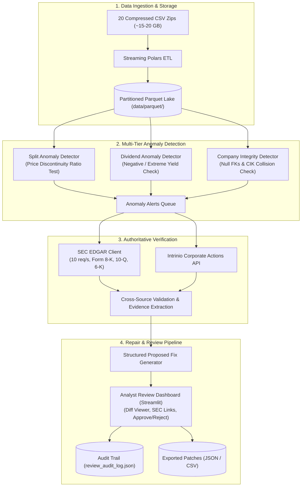

# Corporate Action Integrity and Repair System

An automated historical data cleanup and ongoing data-quality monitoring system for US equities and OTC securities corporate actions.

---

## 🎯 Project Goals (In Order of Importance)

The system is designed to systematically identify and deliver structured proposed fixes for data quality issues:

1. **Missing splits and dividends:**
   - Detect unrecorded forward and reverse splits where price shifts sharply (e.g. 50% drop, 5x jump) while `SPLIT_RATIO == 1.0`.
   - Identify corrupted or inverted split ratios.
   - Detect missed quarterly dividends and flag impossible negative or extreme dividend payouts (>30% yield).
2. **Securities associated with the wrong company:**
   - Detect when an OTC security inherits unrelated company history due to historical ticker reassignment or CIK collision.
   - Flag securities mapping to multiple distinct CIKs across time.
3. **Securities missing a company:**
   - Every common stock security must have an active parent company association.
   - Resolve orphaned securities where `COMPANY_ID` is `NULL` or empty using SEC EDGAR CIK directories.
4. **Companies and securities with incorrect metadata after a merger/acquisition:**
   - Track post-M&A corporate actions (Item 2.01 Form 8-K filings) to identify obsolete tickers and surviving entities.
5. **Incorrect or missing conversion values:**
   - Clean up conversions of stock into stock of another company or cash resulting from mergers, acquisitions, and demergers.

---

## 🏗️ System Flow & Architecture



---

## 📋 Structured Proposed Fix Specification

Every proposed fix is machine-readable, consistent, and provides all necessary information for automatic patching or analyst verification:

```json
{
  "fix_id": "fix_9e8436ca210cc947",
  "ticker": "AVEO",
  "security_id": "sec_0XLjqy",
  "company_id": "com_z59amz",
  "cik": "0001325879",
  "date": "2013-05-02",
  "type": "split",
  "field": "SPLIT_RATIO",
  "current_value": 1.0,
  "value": 2.0,
  "action": "create",
  "confidence": 0.98,
  "source": "algorithmic_anomaly",
  "source_id": "0001325879-13-000021",
  "source_url": "https://www.sec.gov/Archives/edgar/data/1325879/...",
  "supporting_evidence": "Identified 2:1 forward split via overnight price movement: close dropped from $5.26 to $2.65 (ratio: 0.5038) while SPLIT_RATIO was 1.0.",
  "status": "pending_review"
}
```

---

## 📁 Repository Layout

```text
├── .gitignore
├── requirements.txt
├── README.md
├── src/
│   ├── config.py                 # Central configuration, paths & split thresholds
│   ├── pipeline.py               # End-to-end detection orchestration
│   ├── models/
│   │   └── schemas.py            # Pydantic models for AnomalyAlert & ProposedFix
│   ├── etl/
│   │   └── convert_to_parquet.py # Streaming CSV-to-Parquet converter
│   ├── detectors/
│   │   ├── base.py               # Abstract BaseDetector class
│   │   ├── split_detector.py     # Forward/reverse missing split detector
│   │   ├── dividend_detector.py  # Dividend anomaly & extreme yield detector
│   │   └── company_detector.py   # Missing company & CIK collision detector
│   └── research/
│       └── sec_client.py         # SEC EDGAR client (10 req/s compliant)
├── dashboard/
│   └── app.py                    # Streamlit human-in-the-loop analyst review dashboard
├── tests/
│   └── test_split_detector.py    # Unit tests for split anomaly detection
└── data/
    ├── parquet/                  # Converted Parquet dataset (excluded from git)
    └── output/                   # Proposed fixes and audit logs
```

---

## ⚡ Quickstart Guide

### 1. Run Unit Tests
```powershell
python -m unittest tests/test_split_detector.py
```

### 2. Convert Raw CSV Zips to Parquet Data Lake
Converts all 20 raw CSV zip files (~15–20 GB uncompressed) into compressed Parquet in under 1 minute:
```powershell
python -m src.etl.convert_to_parquet
```

### 3. Run Anomaly Detection & Generate Proposed Fixes
```powershell
python -m src.pipeline --limit-files 5 --output proposed_fixes.json
```

### 4. Launch Analyst Review Dashboard
```powershell
streamlit run dashboard/app.py
```

---

## 🔐 Data Access & Compliance
- **SEC Filings**: Fetched via SEC EDGAR REST API with custom User-Agent headers adhering to the 10 req/s rate limit.
- **Intrinio API**: Supports Intrinio Corporate Actions API integration.
- **Licensing Compliance**: Only authorized, primary public filings (SEC, issuer press releases, FINRA notices) are used for model evidence and validation.
